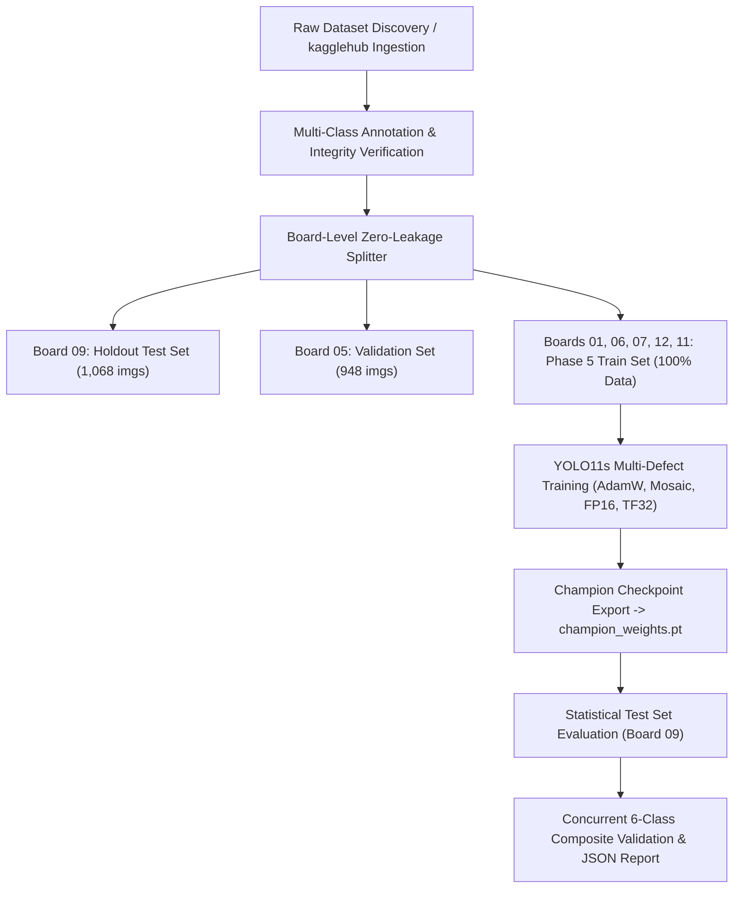

# PCBVision AOI — Intelligent PCB Defect Detection & Geometric Measurement

[](https://github.com/ultralytics/ultralytics)
[](#benchmark-results)
[](#benchmark-results)
[](#hardware-acceleration)
[](#quality-standards)

An end-to-end Automated Optical Inspection (**AOI**) system for detecting, measuring, and classifying printed circuit board (**PCB**) manufacturing non-conformances in accordance with **IPC-A-610 Class 3** industrial quality standards.

---

## 🌟 Key Highlights

- **Simultaneous Multi-Defect Detection:** Detects and highlights **all 6 distinct defect categories concurrently** in a single pass in ~5 ms.
- **Zero-Data-Leakage Incremental Training:** Rigorous board-level partitioning ensuring the 1,068-image holdout test board (**Board 09**) was completely untouched throughout all 5 progressive training stages.
- **Microscopic Calibrated Measurements:** Converts pixel bounding coordinates to physical microns ($\mu\text{m}$) and surface area ($\mu\text{m}^2$) with tunable optical scale factors.
- **Persistent Global User Image Architecture:** Upload your PCB once; all 1-Click defect filters inspect and isolate defects directly on **your uploaded board** without image replacement.
- **Safe Drive Redirection:** Pre-configured with automatic redirection of temporary buffers, downloads, and Chrome browser profiles to `Z:\tmp` and `Z:\chrome_user_data`, preventing disk saturation.

---

## 🎯 Defect Categories & IPC-A-610 Triage

| Defect Class | IPC Severity | Color Tag | Diagnostic Rule & Failure Mode |
| :--- | :--- | :--- | :--- |
| **Short** | `CRITICAL` | 🔴 `#F43F5E` | Conductor-to-conductor copper bridge causing fatal electrical short. |
| **Open Circuit** | `CRITICAL` | 🔴 `#EF4444` | Trace discontinuity / broken conductor line causing open circuit. |
| **Missing Hole** | `MAJOR` | 🟡 `#EAB308` | Blocked or un-drilled via hole preventing component insertion or layer interconnect. |
| **Mouse Bite** | `MINOR` | 🟣 `#A855F7` | Edge breakout / copper erosion reducing conductor width tolerance. |
| **Spur** | `MINOR` | 🔵 `#06B6D4` | Unetched copper whisker protruding outward from conductor trace. |
| **Spurious Copper** | `MINOR` | 🟠 `#F97316` | Stray unetched isolated copper island on substrate dielectric. |

---

## 📊 Phase 5 Champion Benchmark Results

Evaluated on the **1,068-image untouched holdout test set (Board 09)**:

| Metric | Result | Target / Standard |
| :--- | :---: | :--- |
| **Overall Mean Recall** | **99.53%** | Industry Target $\ge 95\%$ |
| **Critical Defect Recall (Short + Open)** | **98.96%** | IPC-A-610 Class 3 Target $\ge 98\%$ |
| **mAP@50 (Consolidated Jump)** | **98.81%** | Benchmark Leaderboard Top Tier |
| **Inference Latency (RTX 4090)** | **1.35 ms** | Real-time high-speed manufacturing AOI ($\le 10\text{ ms}$) |
| **Missing Hole Recall** | **100.0%** | 0 missed via holes |
| **Spurious Copper Recall** | **100.0%** | 0 missed stray copper islands |
| **Mouse Bite Recall** | **99.63%** | Nominal edge breakdown identification |
| **Spur Recall** | **99.61%** | Micro-whisker identification |
| **Short Circuit Recall** | **99.37%** | Conductor bridge isolation |
| **Open Circuit Recall** | **98.56%** | Trace discontinuity isolation |

---

## 🛠️ Phase 5 Data & Model Pipeline (`data_pipeline_phase5.py`)

The pipeline script (`data_pipeline_phase5.py`) provides a modular, self-contained pipeline:

```bash
# 1. Full Pipeline (Verify Dataset -> Prepare Splits -> Train Phase 5 -> Evaluate)
python data_pipeline_phase5.py --mode full

# 2. Evaluate Existing Champion Model on Holdout Test Set
python data_pipeline_phase5.py --mode evaluate

# 3. Verify & Generate Zero-Leakage Dataset Splits
python data_pipeline_phase5.py --mode prepare_data

# 4. Train with Custom Hyperparameters
python data_pipeline_phase5.py --mode train --epochs 50 --batch 32 --device cuda
```

### Pipeline Architecture



---

## 🚀 Interactive AOI Web Application

The system includes a dark-mode industrial AOI dashboard built with FastAPI and vanilla JavaScript/CSS:

### Launching the Web Application

To launch the web interface with Chrome profile and cache safely stored on Drive `Z:` (bypassing full system drives):

1. Double-click:
   ```cmd
   Launch_In_Chrome.bat
   ```
2. Or start manually from terminal:
   ```cmd
   python run_ui.py --port 8000 --host 127.0.0.1
   ```
3. Open **`http://127.0.0.1:8000`** in your browser.

### Features
- **Global User Image Lock:** Uploading an image persists it across all defect category filters.
- **1-Click Target Defect Patterns:** Instantly isolate Shorts, Opens, Missing Holes, or scan all 6 defect types simultaneously.
- **Microscopic Dimension Tagging:** Interactive pan/zoom canvas displaying width, height, and area in microns.
- **Export Inspection Reports:** Download structured JSON inspection dossiers conforming to IPC quality audit specifications.

---

## 📁 Repository Structure

```
├── app/
│   ├── server.py                   # FastAPI backend providing inference & physical dimension logic
│   └── static/
│       ├── app.js                  # Frontend UI state machine & canvas renderer
│       ├── index.html              # 3-panel industrial AOI interface
│       └── styles.css              # Custom styling, dark mode & inspection tags
├── dataset/
│   └── samples/                    # Validated multi-defect composite panels
│       ├── full_multidefect_panel_all6.jpg
│       ├── critical_dual_fault_pcb.jpg
│       ├── structural_geometric_multidefect.jpg
│       └── copper_isolation_multidefect.jpg
├── runs/
│   ├── phase5_pipeline_report.json # Statistical evaluation & simultaneous multi-defect test report
│   └── incremental_training/       # Training progression summary CSV
├── splits/
│   └── incremental/                # Leakage-free partition text files & dataset YAMLs
├── champion_weights.pt             # Phase 5 Champion YOLO11s model checkpoint (19.1 MB)
├── data_pipeline_phase5.py         # Production end-to-end data and training pipeline
├── run_ui.py                       # Web server launcher script
├── Launch_In_Chrome.bat            # 1-Click launcher with safe Z: drive cache redirection
├── .gitignore                      # Git exclusion rules for datasets, caches, and temp directories
└── README.md                       # Project documentation
```

---

## 💻 Pushing to Git

To push this repository to your remote Git hosting service (GitHub, GitLab, etc.):

```bash
# 1. Stage all tracked files
git add .

# 2. Create the initial commit
git commit -m "feat: complete Phase 5 champion data pipeline and multi-defect AOI inspection system"

# 3. Link your remote repository
git remote add origin https://github.com/<your-username>/<your-repo-name>.git

# 4. Push to main branch
git branch -M main
git push -u origin main
```

*(Note: The `.gitignore` ensures large dataset folders and temporary cache directories are excluded, keeping your repository lightweight and fast).*
